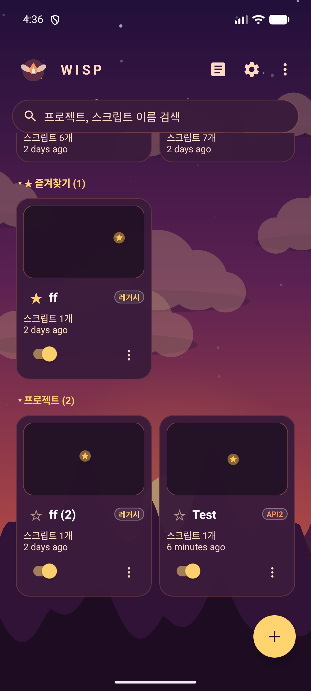
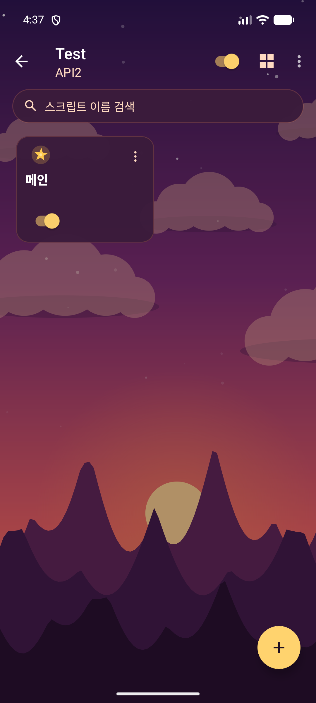
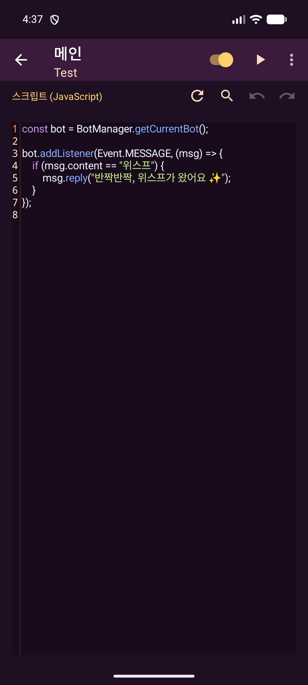
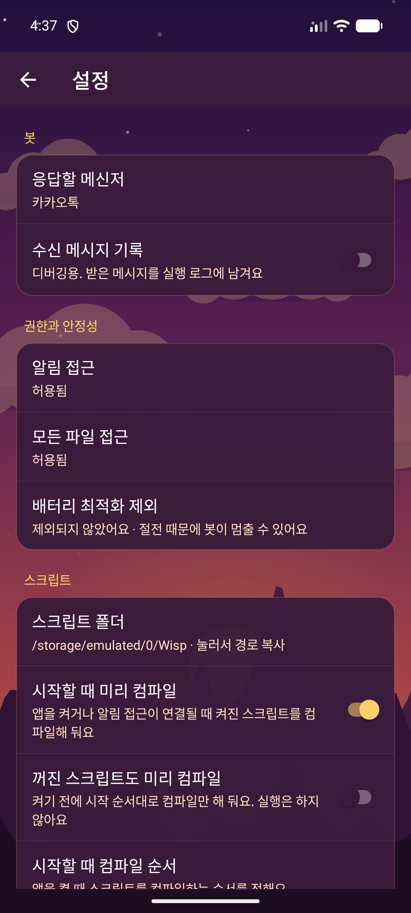
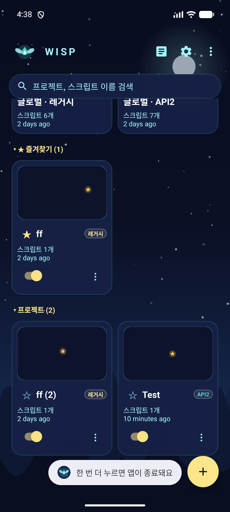
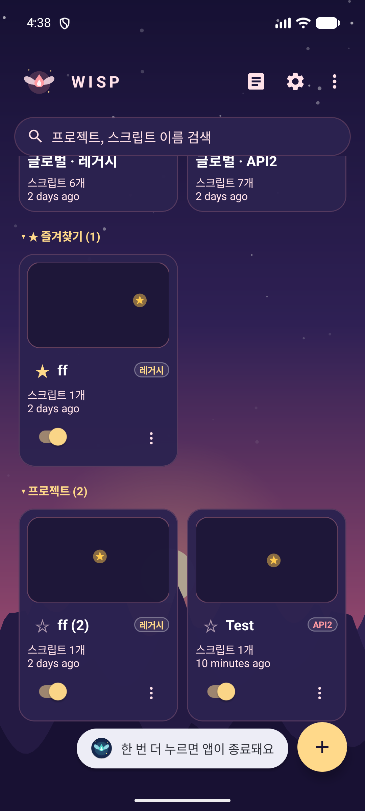
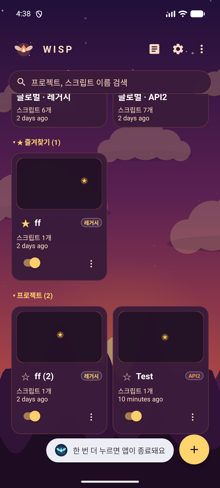
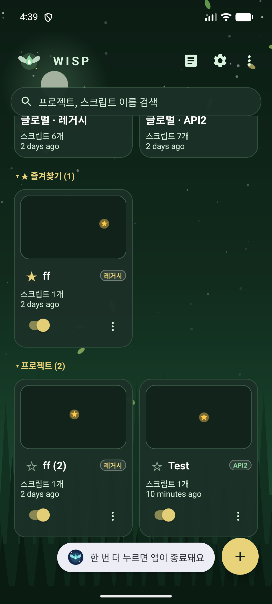
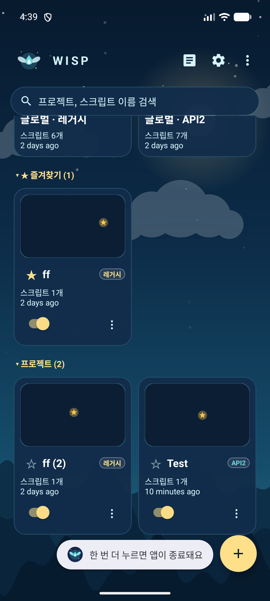

# Wisp

Wisp은 안드로이드에서 JavaScript 스크립트로 메신저 메시지에 자동 응답을 만드는 앱입니다. 이 저장소는 Wisp 앱의 **설치 파일(APK)을 내려받는 곳**입니다. 소스 코드는 공개하지 않습니다.

## 주요 기능

**스크립트 작성과 실행**
- 앱 안에서 JavaScript 스크립트를 작성하고 편집합니다. 구문 강조, 찾기, 편집기 설정을 지원합니다.
- 스크립트를 켜고 끄고, 여러 개를 한 번에 컴파일할 수 있습니다.
- 스크립트 실행 순서를 정할 수 있습니다.
- 프로젝트 단위로 스크립트를 묶어 관리합니다. 목록 정렬, 검색, 그룹, 즐겨찾기를 지원합니다.

**메시지 자동 응답**
- 카카오톡 등 메신저의 알림을 읽어 스크립트에 전달합니다. 이를 위해 알림 접근 권한이 필요합니다.
- 메시지에 답장하기, 지정한 방으로 보내기, 방 읽음 처리, 답장 가능한 방 목록 조회를 할 수 있습니다.
- 다른 앱의 방으로 보내는 기능도 있습니다.

**이벤트**
- `message`: 메시지가 올 때마다 실행됩니다.
- `command`: 정해 둔 명령어(예: `!시간`)에 반응합니다.
- `tick`: 일정 간격으로 반복 실행됩니다.
- `startCompile`: 스크립트가 시작될 때 한 번 실행됩니다.

**시험하기**
- 시험방: 알림 없이 카카오톡 채팅방처럼 생긴 화면에서 스크립트를 시험할 수 있습니다.
- 메시지 콘솔과 실행 로그에서 결과를 확인합니다.
- 변수 화면에서 스크립트가 저장한 값을 볼 수 있습니다.

**홈 화면 위젯**
- 전체 컴파일, 전체 끄기, 최근 메시지를 홈 화면에서 바로 확인하고 조작합니다.

**가져오기와 내보내기**
- 프로젝트 전체를 zip 파일로 내보내고 다시 가져올 수 있습니다.
- 스크립트 하나를 `.js` 파일로 내보내고, PC에서 만든 `.js` 파일을 가져올 수 있습니다.
- 파일 열기 화면에서 텍스트와 JSON 파일을 볼 수 있습니다.

**스크립트에서 쓸 수 있는 도구**
- 토스트 메시지, 진동, 알림창, 클립보드 복사
- 기기 정보(모델, 안드로이드 버전, 배터리 잔량)
- 웹 요청(HTTP)
- 파일 읽기와 쓰기, 값 저장
- base64 변환, UUID 생성, 타이머

**도움말**
- 앱 안에 명령 예제와 API 설명이 들어 있습니다.

## 스크린샷

| 프로젝트 목록 | 스크립트 목록 | 스크립트 편집 | 설정 |
| --- | --- | --- | --- |
|  |  |  |  |

**테마**

설정 → 테마에서 아래 다섯 가지 중 고를 수 있습니다.

| 밤하늘 | 새벽 | 저녁 노을 | 숲 | 바다 |
| --- | --- | --- | --- | --- |
|  |  |  |  |  |

## 필요한 권한

- **알림 접근**: 메신저 알림을 읽어 자동 응답하려면 필요합니다.
- **모든 파일 접근**: `/sdcard/Wisp` 폴더를 PC에서 직접 편집하려면 필요합니다.
- **배터리 최적화 제외**: 알림을 받는 서비스가 꺼지지 않도록 요청합니다. 허용하지 않아도 앱은 동작하지만, 기기에 따라 서비스가 멈출 수 있습니다.
- **인터넷**: 웹 요청 기능에 필요합니다.

## 설치 방법

1. [Releases](https://github.com/Morph-house/Wisp-releases/releases) 페이지를 엽니다.
2. 최신 버전(예: `v1.0.0`)을 찾아 **Assets** 항목을 펼칩니다.
3. `app-release.apk`를 클릭해 다운로드합니다. 로그인하지 않아도 받을 수 있습니다.
4. 다운로드한 파일을 실행해 설치합니다.

처음 설치할 때 "출처를 알 수 없는 앱" 경고가 나오면, 설정에서 이 앱(브라우저나 파일 관리자)의 **설치 허용**을 켠 뒤 다시 실행하세요. Play 스토어가 아닌 곳에서 받은 APK라서 표시되는 경고입니다.

## 시스템 요구사항

- 안드로이드 12L (API 32) 이상

## 업데이트

새 버전이 나오면 Releases 페이지에서 최신 APK를 받아 설치하면 됩니다. 같은 서명 키로 만들어진 버전이므로 기존 앱 위에 덮어써집니다. 기존 데이터는 그대로 유지됩니다.

## 문의 및 버그 제보

문제가 생기면 [Issues](https://github.com/Morph-house/Wisp-releases/issues) 탭에 남겨 주세요. 어떤 기기와 안드로이드 버전에서 발생했는지 함께 적어 주시면 도움이 됩니다.

개발자와 직접 이야기하고 싶다면 카카오톡 오픈채팅방에 들어와 주세요: [Wisp 개발자 오픈채팅](https://open.kakao.com/o/g3wp7UBb)
